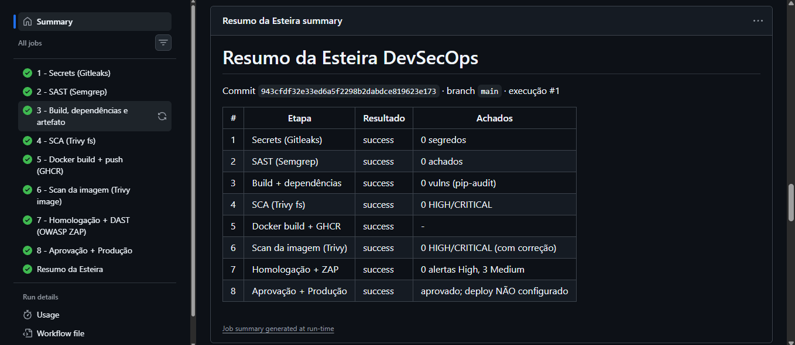

# 🛡️ Security Alert – Esteira DevSecOps


**Security Alert** é um jogo web de treinamento em cibersegurança para colaboradores da Leroy Merlin. Foi desenvolvido no Challenge 2026 da FIAP, com Flask, SQLite e Jinja2. O jogador passa por fases sobre senhas seguras, phishing, engenharia social, classificação de dados e uso seguro de IA, conquista badges e recebe um certificado.

Este repositório leva a aplicação até a produção por uma **esteira DevSecOps em 8 etapas no GitHub Actions** (atividade CP 03 – DevSecOps).

## 👥 Integrantes

| Nome | RM |
|------|----|
| Ana Luiza | RM565711 |
| Maria Eduarda | RM564771 |
| Pedro Henrique | RM565184 |
| Thalia Aiko | RM561758 |

## 🔄 Diagrama da esteira

```
push (main)
   │
   ▼
[1 Gitleaks] → [2 Semgrep] → [3 Build/Deps/Artefato] → [4 Trivy fs]
                                                            │
   ┌────────────────────────────────────────────────────────┘
   ▼
[5 Docker → GHCR] → [6 Trivy image] → [7 Homologação + ZAP]
                                              │
                                     ⏸ aprovação humana (environment producao)
                                              ▼
                                   [8 Deploy produção]
                                              │
                                   [★ Resumo da Esteira]  (sempre executa)
```

## 📋 Etapas

Os relatórios ficam nos **artifacts** de cada execução, em Actions → execução → *Artifacts*. O detalhamento de cada etapa está em [`docs/pipeline.md`](docs/pipeline.md).

| # | Etapa | Ferramenta | Objetivo | Quality gate | Relatório (artifact) |
|---|-------|-----------|----------|--------------|----------------------|
| 1 | Verificação de secrets | Gitleaks 8.30.1 | Nenhuma credencial no código ou no histórico | Bloqueia | `relatorio-01-gitleaks` |
| 2 | SAST | Semgrep (`p/default`, `p/owasp-top-ten`, `p/python`) | Vulnerabilidades no código-fonte | Bloqueia | `relatorio-02-semgrep` |
| 3 | Build, dependências e artefato | pip `--require-hashes`, pipdeptree, pip-audit, pytest | Build reprodutível, inventário, testes e artefato por SHA | Bloqueia (build/testes) | `relatorio-03-build`, `artefato-aplicacao-<SHA>` |
| 4 | SCA | Trivy fs | CVEs em dependências, misconfig e secrets | Bloqueia HIGH/CRITICAL | `relatorio-04-trivy-sca` |
| 5 | Docker build + push | Buildx + GHCR (+ Cosign e SBOM, bônus) | Imagem imutável (tag = SHA, referência por digest) | Bloqueia (falha de build) | `relatorio-05-docker-build` |
| 6 | Scan da imagem | Trivy image | CVEs do SO base e das bibliotecas da imagem | Bloqueia HIGH/CRITICAL com correção | `relatorio-06-trivy-image` |
| 7 | Homologação + DAST | OWASP ZAP Baseline | Falhas em tempo de execução (cabeçalhos, cookies…) | Informativo | `relatorio-07-homologacao-zap` |
| 8 | Aprovação + produção | GitHub Environments + Render | Deploy só após aprovação humana | Aprovação manual | `relatorio-08-producao` |
| ★ | Resumo da Esteira | jq + Job Summary | Consolida status e achados | Sempre executa | `resumo-da-esteira` |

**Link para os relatórios da execução mais recente:** [Actions → DevSecOps Pipeline](https://github.com/thalia-ay/security-alert-devsecops/actions/workflows/devsecops.yml). Abra a execução mais recente e role até *Artifacts*.

### Diferença entre a etapa 4 (Trivy fs) e a etapa 6 (Trivy image)

- **Etapa 4** analisa o que a equipe declara: as dependências Python em `src/requirements.txt`, a configuração do `Dockerfile` e segredos nos arquivos.
- **Etapa 6** analisa o que vai de fato para produção: a imagem final, com os pacotes do Debian da imagem base `python:3.12-slim`, o interpretador Python e as bibliotecas instaladas.
- Vulnerabilidades da **imagem base** só aparecem na etapa 6. Por isso o Dockerfile usa imagem `slim`, aplica `apt-get upgrade` e remove o `pip` da imagem final.
- Resultado da execução #1:
  - **Etapa 4:** 0 vulnerabilidades nas dependências.
  - **Etapa 6:** 185 CVEs no SO base Debian 13.7, sendo 45 HIGH, 0 CRITICAL e nenhuma com correção disponível. As bibliotecas Python da imagem têm 0 CVEs.
  - **Gate:** com `--ignore-unfixed`, o gate da etapa 6 passou.

## 💻 Como executar localmente

Pré-requisito: Python 3.12.

```bash
git clone https://github.com/thalia-ay/security-alert-devsecops.git
cd security-alert-devsecops
python -m venv venv
source venv/bin/activate            # Windows: venv\Scripts\activate
pip install --require-hashes -r src/requirements.txt

# Local via HTTP: o cookie Secure precisa ser desativado
export SESSION_COOKIE_SECURE=false  # Windows (PowerShell): $env:SESSION_COOKIE_SECURE="false"
export SECRET_KEY="$(python -c 'import secrets;print(secrets.token_hex(32))')"
cd src
python app.py
```

Depois, acesse http://localhost:5000. O banco SQLite é criado automaticamente em `src/instance/` e não é versionado.

**Testes:**

```bash
pip install -r src/requirements-dev.txt
pytest tests/ -v --cov=src
```

## 🐳 Como executar via Docker

```bash
docker build -t security-alert .
docker run --rm -p 5000:5000 \
  -e SECRET_KEY="troque-por-um-valor-aleatorio" \
  -e SESSION_COOKIE_SECURE=false \
  security-alert
```

Para usar a imagem publicada pela esteira (sempre pelo SHA, nunca `latest`):

```bash
docker pull ghcr.io/thalia-ay/security-alert-devsecops:<SHA_DO_COMMIT>
```

### Variáveis de ambiente

| Variável | Obrigatória | Descrição |
|----------|-------------|-----------|
| `SECRET_KEY` | Sim, em produção | Chave fixa de assinatura das sessões |
| `SESSION_COOKIE_SECURE` | Não (padrão `true`) | Use `false` só para rodar localmente via HTTP |
| `DATABASE_PATH` | Não | Caminho do SQLite. O padrão é `instance/security_alert.db`. |
| `ADMIN_USERNAME`, `ADMIN_EMAIL`, `ADMIN_PASSWORD` | Não | Criam o admin inicial. A senha precisa ter no mínimo 12 caracteres. |
| `DEBUG` | Não (padrão `false`) | Só para desenvolvimento local; **nunca** em produção |

## ⚙️ Configuração pós-clone (obrigatória para a esteira completa)

1. **Settings → Actions → General → Workflow permissions:** selecionar **Read and write permissions**, necessário para publicar no GHCR.
2. **Settings → Environments → New environment → `homologacao`:** criar o ambiente, sem revisores.
3. **Settings → Environments → New environment → `producao`:**
   - **Required reviewers:** adicionar pelo menos 1 integrante.
   - **Deployment branches:** *Selected branches* → `main`.
   - **Environment secrets:** `RENDER_DEPLOY_HOOK_URL`, o Deploy Hook do serviço no Render.
   - **Environment variables:** `PRODUCTION_URL`, a URL pública do serviço.
4. **Settings → Secrets and variables → Actions:** secret `SECRET_KEY`. É opcional na homologação; sem ele, a esteira gera uma chave efêmera.
5. **Render** (ou outro provedor):
   - Criar um *Web Service* do tipo **Existing Image** apontando para `ghcr.io/thalia-ay/security-alert-devsecops:<SHA>`.
   - Se o pacote do GHCR for privado, torná-lo público em Packages → Package settings ou cadastrar uma credencial de registry no Render.
   - Definir no serviço as variáveis `SECRET_KEY` e, se quiser, as `ADMIN_*`.
   - Copiar o *Deploy Hook* para o secret `RENDER_DEPLOY_HOOK_URL`.

Sem o passo 5, a etapa 8 roda depois da aprovação, mas **não faz deploy**. Isso fica explícito no relatório `relatorio-08-producao` e no Resumo.

## 📸 Print do Resumo da Esteira

Execução #1 ([link](https://github.com/thalia-ay/security-alert-devsecops/actions/runs/41516785203)): todas as etapas `success`, 5m 9s, 12 artifacts.



> Na execução #1, a etapa 8 aparece como `success` sem ter havido aprovação humana, porque o environment `producao` ainda não tinha *Required reviewers*. Isso foi corrigido: a execução [#9](https://github.com/thalia-ay/security-alert-devsecops/actions/runs/41528928961) esperou a aprovação e fez o deploy real no Render. A execução bloqueada pelo quality gate é a [#8](https://github.com/thalia-ay/security-alert-devsecops/actions/runs/41527602124). Detalhes em [`docs/observacoes.md`](docs/observacoes.md).

As demais evidências ficam em [`docs/evidencias/`](docs/evidencias/):
- execução completa;
- execução bloqueada por quality gate;
- tela de aprovação do environment `producao`;
- imagem em Packages;
- jogo em produção.

## ✅ Registro de aprovação humana

| Execução | Aprovado por | Data/hora | Decisão | Base da decisão |
|----------|--------------|-----------|---------|-----------------|
| [#5](https://github.com/thalia-ay/security-alert-devsecops/actions/runs/41526012116) (manual, commit `a477ace`) | `analu-a` (Ana Luiza) | 02/11/2026 | Aprovado | Etapas 1 a 7 verdes; deploy não executado porque o Render ainda não estava configurado |
| [#9](https://github.com/thalia-ay/security-alert-devsecops/actions/runs/41528928961) (push, commit `d1ebd7c`) | `analu-a` (Ana Luiza) | 02/11/2026, etapa 8 iniciada às 21:42:49 UTC, após a espera pela aprovação | Aprovado | Gitleaks 0 segredos; Semgrep e Trivy fs/image sem bloqueio; ZAP sem alertas High |

## 🌐 URL de produção

**https://security-alert-devsecops.onrender.com/** (Render, plano Free)

Deploy real executado na execução [#9](https://github.com/thalia-ay/security-alert-devsecops/actions/runs/41528928961), com a imagem pelo digest `ghcr.io/thalia-ay/security-alert-devsecops@sha256:7707654e666d31bb63367113dff72e895bbbcfaa0942cf591d88aa65d6e5c393`. O health check da esteira (`/login`) retornou "Produção respondendo".

> No plano Free, o serviço hiberna quando fica ocioso, e o primeiro acesso pode levar cerca de 1 minuto. O SQLite é efêmero e é apagado a cada novo deploy ou reinício.

## 📚 Documentação

- [`docs/pipeline.md`](docs/pipeline.md): explicação de cada etapa
- [`docs/observacoes.md`](docs/observacoes.md): achados, correções, falsos positivos, adaptações para Python, limitações e lições aprendidas
- [`docs/evidencias/`](docs/evidencias/): prints das execuções e da aprovação

### Adaptação da stack (Node.js → Python)

O Anexo A do enunciado usa Node.js; esta aplicação usa Python/Flask. A tabela completa de equivalências está em [`docs/observacoes.md`](docs/observacoes.md#adaptações-para-python). Em resumo:
- `npm ci` → `pip install --require-hashes`, com lock gerado por `pip-compile`;
- `npm audit` → `pip-audit`;
- árvore de dependências → `pipdeptree`;
- testes → `pytest`.

## 📁 Estrutura

```
security-alert-devsecops/
├── .github/workflows/devsecops.yml   # esteira completa (8 etapas + resumo)
├── docs/
│   ├── pipeline.md
│   ├── observacoes.md
│   └── evidencias/
├── src/                              # código do jogo (Flask)
│   ├── app.py
│   ├── requirements.in               # dependências diretas
│   ├── requirements.txt              # lock com versões exatas + hashes
│   ├── requirements-dev.txt
│   ├── templates/  static/  personagens/
├── tests/test_app.py                 # testes pytest
├── Dockerfile
├── .dockerignore
└── README.md
```
